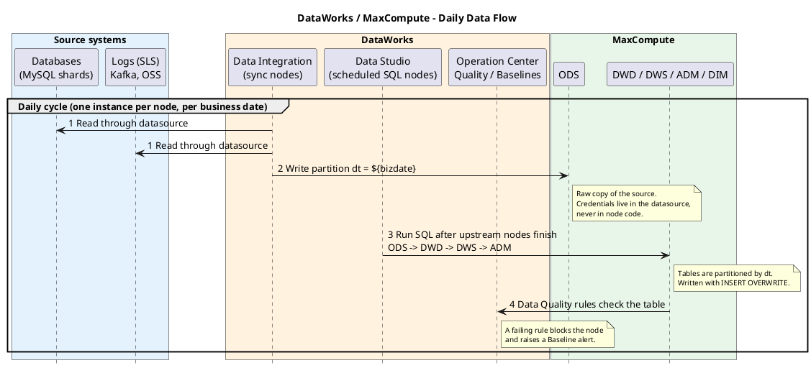
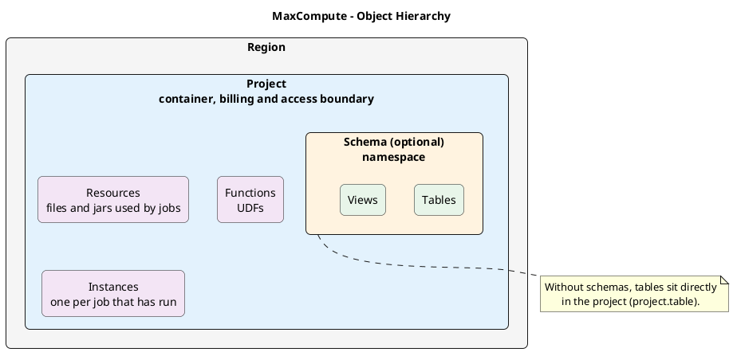

# DataWorks Platform and Infrastructure

> **Status:** working draft. Items marked *(to confirm)* are not yet verified in our environment.

Our data warehouse is built on two Alibaba Cloud products, deployed on Apsara Stack (Alibaba Cloud's private-cloud edition), that work as a pair: **MaxCompute**, which stores the data and runs the SQL, and **DataWorks**, the web platform used to build, schedule, operate and govern everything that runs on top of it. This document describes that platform: what each piece is, how the pieces relate, and how they are set up here. It does not cover data modelling or SQL standards.

**Contents**

1. [Overview](#1-overview)
2. [MaxCompute](#2-maxcompute)
3. [DataWorks](#3-dataworks)
4. [Datasources](#4-datasources)
5. [Our environment](#5-our-environment)

---

## 1. Overview

MaxCompute (also called ODPS, its original name) is a serverless, columnar data warehouse. It holds the tables of every warehouse layer (ODS, DWD, DWS, ADM and DIM) and executes the SQL that transforms them. It has no interface for development or scheduling.

DataWorks supplies that missing side. It plays the role of the IDE, the scheduler (comparable to Airflow), the data catalog and the access-control system, all in one product. A table lives in MaxCompute, but it is normally created, filled and scheduled from DataWorks.

> MaxCompute stores and computes. DataWorks orchestrates and governs.



Data enters through Data Integration, which reads from a source through a datasource and writes to ODS. Scheduled SQL nodes then build each following layer inside MaxCompute, and Operation Center, Data Quality and Baselines watch the result.

## 2. MaxCompute

### 2.1 Object hierarchy



### 2.2 Project

The project is the basic unit of user isolation and access control. Tables, views, resources and functions live inside it, and users, roles and permissions are managed per project. Jobs run on the compute of the quota group assigned to the project, which is also how cost is attributed. A job can read from another project as `project_name.table_name` when it has permission.

The console lists each project with these attributes:

| Attribute | Meaning |
|---|---|
| Name and ID | A unique name, used to address its objects, and a numeric ID |
| Label | Optional tag |
| Organization | The tenant organization the project belongs to |
| Resource set | The set of infrastructure resources the project runs on |
| Control region | The region from which the project is managed |
| Quota group | A pool of compute capacity. Several projects can share one |

A project is not a DataWorks workspace. The workspace binds to one or more projects and uses them as its compute engine (section 3.1).

### 2.3 Schema

A schema is an optional namespace inside a project that groups tables.

| Model | Address |
|---|---|
| Two-layer (classic) | `project.table` |
| Three-layer | `project.schema.table` (enabled per project, with a `default` schema) |

Whether each of our projects uses schemas is *(to confirm)*. Without schemas, tables are grouped by name prefix, which is why naming conventions matter.

### 2.4 Table

A table has named, typed columns and is stored in a compressed columnar format.

| Kind | Description |
|---|---|
| Internal (managed) | Data is stored and managed by MaxCompute. The normal kind |
| External | Metadata in MaxCompute, data left in a store such as OSS |
| Partitioned | Rows split by one or more partition columns, usually `dt` |
| View / materialized view | A stored query, or a stored query with precomputed results |
| Delta | Transactional table with row-level updates and deletes *(to confirm availability)* |

Behaviours worth knowing:

- There are no indexes and no enforced constraints on regular tables. Uniqueness is a modelling and data-quality concern.
- Regular tables are append-and-overwrite oriented. Data is rewritten with `INSERT OVERWRITE` (a whole table or partition) or added with `INSERT INTO`. Row-level `UPDATE` and `DELETE` require a transactional table.
- Comments on tables and columns feed the catalog.
- A lifecycle property sets the number of days after which data is dropped.
- Common column types are `STRING`, `BIGINT`, `DOUBLE`, `DECIMAL`, `BOOLEAN`, `DATETIME`, `TIMESTAMP`, plus `ARRAY`, `MAP` and `STRUCT`.

### 2.5 Referencing objects in SQL

```sql
SELECT col_a FROM my_project.my_table WHERE dt = '20260101';              -- two-layer
SELECT col_a FROM my_project.my_schema.my_table WHERE dt = '20260101';    -- three-layer
SELECT col_a FROM my_table WHERE dt = '20260101';                         -- current project
```

## 3. DataWorks

### 3.1 Core concepts

| Concept | Meaning |
|---|---|
| Workspace | The unit of work. Groups members, nodes, datasources and the MaxCompute projects it computes on |
| Node | One unit of work: an SQL job, a sync job or a shell script, with its own schedule and dependencies |
| Workflow (DAG) | Nodes linked by dependencies. A node runs only after its upstream nodes finish |
| Instance | One run of a node for one business date. Not the same as a MaxCompute instance (a job that has run) |
| Business date | The date a run is for, passed as `${bizdate}`. By default it is the day before the run date, and it normally feeds the `dt` partition |
| Resource group | The compute capacity that runs Data Integration and scheduled nodes |
| DEV / PROD | Two environments. In a workspace in standard mode, each maps to its own MaxCompute project, and code moves between them by submit, review and deploy |

### 3.2 Modules

| Module | Purpose |
|---|---|
| Data Integration | Copies data between systems with sync nodes. This is how source data reaches ODS |
| Data Studio | Development environment: write ODPS SQL, create nodes, set schedules and dependencies |
| Operation Center | Monitor runs, check logs, rerun and backfill |
| Deployment Center | Promote nodes from DEV to PROD after approval |
| DataMap | Search tables, fields and lineage. Works as the data catalog |
| Data Quality | Rules attached to tables. A failing rule can block the node that writes the table |
| Data Asset Governance | Reports on unused tables, storage cost and owners |
| Baselines | SLA monitoring for groups of nodes, with alerts |
| Permissions and roles | Control who can read or write which layer and table |

## 4. Datasources

A datasource is a saved connection to an external system. It stores the system type, its address (JDBC URL, endpoint or bucket), the database or project name and the credentials. Nodes then refer to the system by name instead of repeating connection details, and credentials never appear in node code.

Data Integration uses datasources as the source or destination of a sync, and SQL nodes use them to read from or write to a system. Each datasource points to a single database, so a sharded source appears as one datasource per shard. MaxCompute is itself a datasource (type `odps`) and is the destination of ingestion.

## 5. Our environment

Verified from the DataWorks datasource registry:

- **Datasources:** 269 registered. They cover MySQL-compatible databases, SLS logs (`loghub`), OSS buckets, Kafka, Lindorm, Elasticsearch and MaxCompute.
- **Sharding:** most transactional sources are split into ten shards numbered `00` to `09`, each registered as its own datasource (for example `aqc00` to `aqc09`, `apbiz00` to `apbiz09`). A few shared or configuration databases have a single datasource (for example `accshare`, `fluxshare`).
- **Logs:** application business logs are read from SLS projects, one datasource per domain (acquiring, customer, fund, risk, wireless).
- **Object storage:** OSS buckets are used for export and synchronisation files.
- **Streaming:** a Kafka cluster hosted outside Alibaba Cloud (AWS, us-west-2) is registered as a datasource.
- **Region:** endpoints resolve to the Querétaro (`mx-queretaro`) deployment.

To confirm and add: workspace names and mode, MaxCompute project names for DEV and PROD, whether schemas are enabled, and the resource groups in use.
